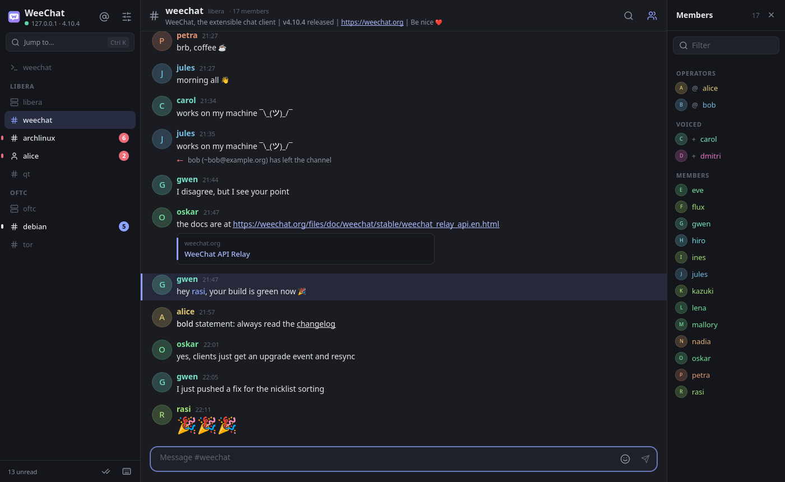
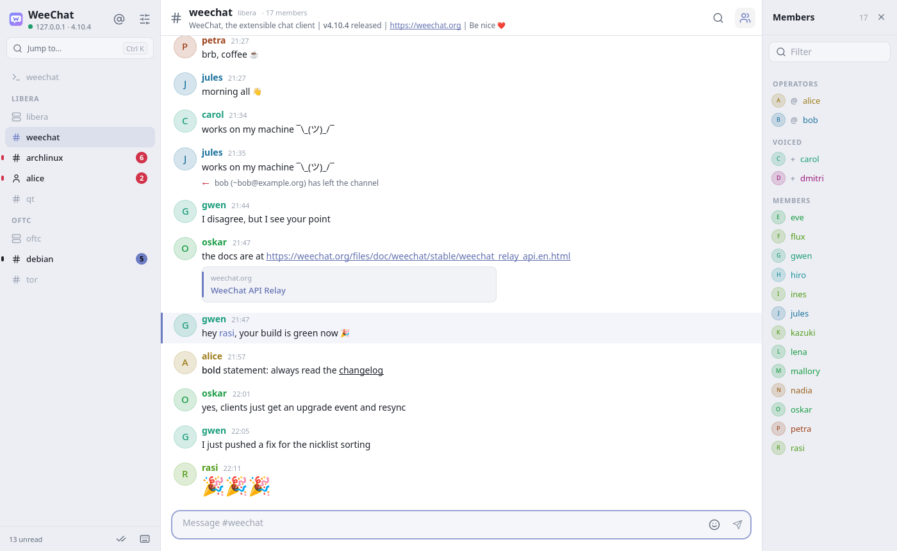
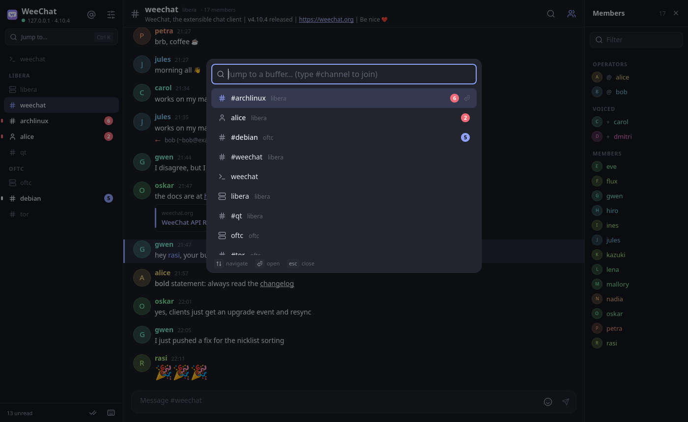
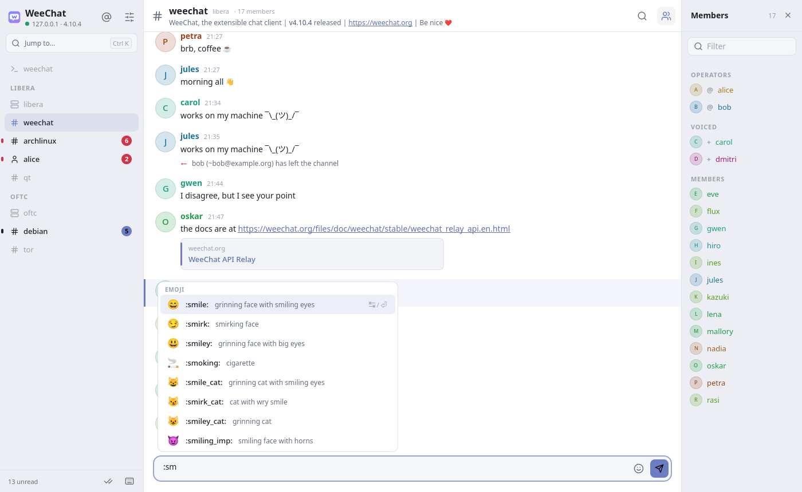
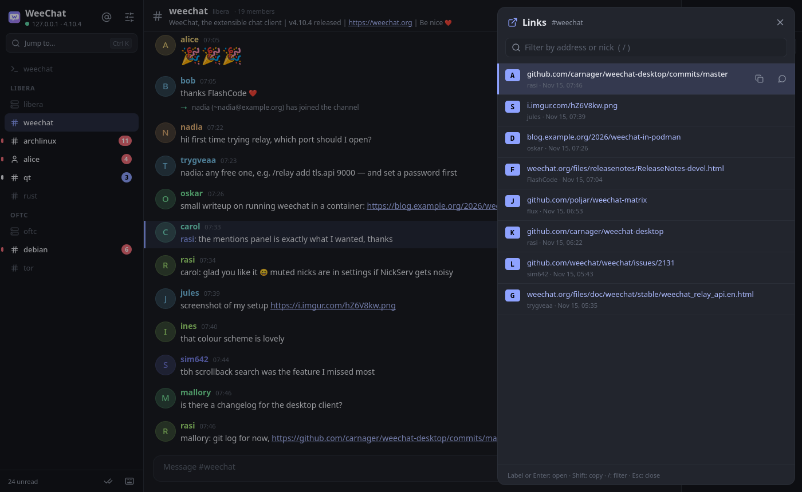
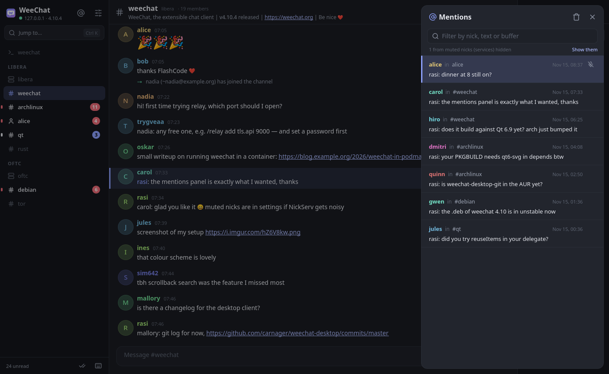
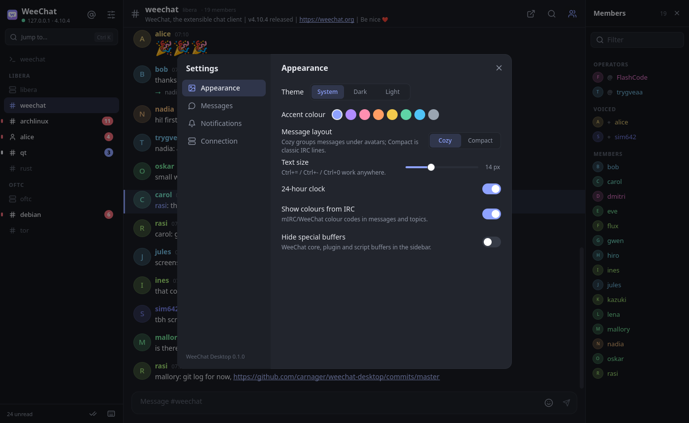

# WeeChat Desktop

A modern desktop client for [WeeChat](https://weechat.org/), built with Qt 6 (C++ and QML).

It talks to WeeChat over the **`relay api`** protocol (JSON over WebSocket, WeeChat 4.0+), the
same way [weelay](../weelay) does on Android. It keeps WeeChat's model (buffers, hotlist, nick
colours, IRC lines) and adds what a desktop should have: emoji, link previews, notifications, a
quick switcher, and a keyboard-first workflow that still works well with a mouse.

## Screenshots



<p>
  
  
  
</p>
<p>
  
  
  
</p>

## Features

- **Keyboard first:** Ctrl+K quick switcher (fuzzy, unread-aware; type `#chan` to join),
  Alt+1…0, Alt+↑/↓, Alt+A for next unread (highlights first), Tab nick completion that cycles
  like WeeChat's, a nick picker after `/query`, `/msg`, `/notice`, `/whois`, `/kick` and friends, input history, PageUp/PageDown, and F1 for the full list.
- **Emoji:** `:shortcode` suggestions as you type, a searchable picker (Ctrl+E) with recently
  used emoji, `:tada:` → 🎉 in sent and received messages, and big emoji for emoji-only messages.
  Emoji the installed font can't draw are hidden.
- **Messages:** a Cozy layout (avatars, grouped messages) or a Compact IRC-style one;
  mIRC/WeeChat colours, clickable links and `#channels`, a "NEW" divider at the first unread
  line, day separators, per-message actions on hover (reply, quote, copy, nick menu) and
  in-buffer search (Ctrl+F).
- **Links from the keyboard:** Ctrl+O puts a label on every link on screen; type it to open the
  link, or hold Shift to copy it. Ctrl+Shift+O lists all links in the buffer's loaded history,
  newest first, with the same labels and a filter.
- **Previews (opt-in):** OpenGraph cards for links, plus inline images and GIFs (GIFs play on
  hover). Off by default, since fetching tells the site your IP address; turn them on in
  Settings. Results are cached for a week, with image sizes, so previews don't shift the chat.
- **Unread state comes from WeeChat's hotlist.** Reading a buffer here marks it read in WeeChat
  too. There's also a mentions panel (Ctrl+Shift+M) collecting highlights from every buffer,
  with a filter. Highlights from muted nicks (NickServ, ChanServ and other services by default;
  Settings → Notifications) don't show there, count or notify.
- **Now playing:** `/np` shares what your music player is playing (`/me np: Artist – Title` by
  default; the format is configurable). Pick the player in Settings → Messages. Only that MPRIS
  player is asked, so a video in a browser tab never ends up in a channel. With no player
  picked, `/np` goes to WeeChat unchanged.
- **Notifications:** freedesktop notifications for highlights and private messages; clicking one
  opens the buffer. Optional tray icon with an unread badge, and close-to-tray.
- **Nicklist:** ops, voiced and members, with filtering. Clicking a nick opens a native desktop
  menu (message, mention, op, voice, kick, ban), and **Info…** opens a window with the /whois
  reply laid out: real name, host, account, channels, server, idle time.
- **Connection:** `ws://` or `wss://`, self-signed certificates can be trusted by SHA-256
  fingerprint (and you're warned if it changes), automatic reconnect with backoff, and a ping
  watchdog for half-open sockets.
- **Looks:** dark, light or follow-the-system themes, eight accent colours, adjustable text size
  (Ctrl+= / Ctrl+-), and resizable sidebar and nicklist.

## Requirements

- Qt ≥ 6.9 with: Base (Core, Gui, Widgets, Network, DBus), Declarative (Quick), Quick Controls 2,
  WebSockets, Svg; plus `qt6-imageformats` for WebP and similar.
- CMake ≥ 3.21 and a C++20 compiler.
- A colour emoji font (e.g. Noto Color Emoji).
- WeeChat 4.0+ with an `api` relay:

  ```
  /relay add tls.api 9000       # or: /relay add api 9000 for plain ws://
  /set relay.network.password "your-relay-password"
  ```

On Arch Linux: `pacman -S qt6-base qt6-declarative qt6-websockets qt6-svg qt6-imageformats noto-fonts-emoji`.

To install as a package on Arch: `cd packaging/arch && makepkg -si` builds `weechat-desktop-git`
from the GitHub repository; `WEECHAT_DESKTOP_SRC=file://$PWD/../.. makepkg -si` builds this
checkout's committed state instead.

## Building

```sh
cmake -S . -B build -G Ninja -DCMAKE_BUILD_TYPE=Release
cmake --build build
./build/weechat-desktop
ctest --test-dir build          # unit tests, plus headless UI checks in development builds
sudo cmake --install build      # binary, .desktop file and icon
```

## Development

`tools/mock_relay.py` is a fake relay (Python, needs the `websockets` package). It serves a few
networks and channels and posts random chatter and highlights:

```sh
python3 tools/mock_relay.py --port 9001 --password test
```

Then connect to `127.0.0.1`, port `9001`, password `test`, with TLS off.

To test against a real WeeChat without touching a real network, `tools/mini_ircd.py` is a tiny
IRC server with chatty bots (they join, part, mention you and answer queries):

```sh
python3 tools/mini_ircd.py --port 6699
# in WeeChat:
/set relay.network.password test
/relay add api 9002
/server add mini 127.0.0.1/6699 -notls -autojoin=#weechat,#archlinux,#qt
/connect mini
```

Development builds (any build type but Release, or `-DWD_DEVTOOLS=ON`) include hooks for
headless testing: `--screenshot`, `--screenshot-action` and `WD_FRAMES` below.
`tests/ui_checks.py` (run by `ctest`) uses them to drive the app against the mock relay: drag
selection, wheel scrolling, the multi-line paste prompt, and that long wrapping lines don't send
the layout into a loop.

`WD_DEBUG_RELAY=1` logs every relay frame and connection error to stderr. `WD_FRAMES=<dir>` saves
a frame every 100 ms for the first 4 seconds, to check that startup doesn't visibly re-layout. For headless screenshots:

```sh
QT_QPA_PLATFORM=offscreen ./build/weechat-desktop --screenshot shot.png \
    --screenshot-action switcher   # or: emoji, settings, settings-messages, command, mentions, completion, light, compact, unread
```

`tools/genemoji.py` regenerates `resources/emoji.json` from
[emojibase-data](https://github.com/milesj/emojibase).

### Layout

| Path | What |
| --- | --- |
| `src/RelayConnection.*` | WebSocket, auth, TLS pinning, reconnect, ping watchdog |
| `src/Session.*` | Protocol logic: sync, buffers, lines, hotlist, read state, notifications (`Relay` in QML) |
| `src/Protocol.*` | Pure parsing/classification helpers (unit tested) |
| `src/LineModel.*`, `NickModel.*`, `BufferListModel.*`, `Buffer.*` | Models for the views |
| `src/Formatter.*` | ANSI/mIRC → rich text, links, emoji shortcodes, nick colours |
| `src/Completer.*`, `EmojiStore.*`, `LinkPreviews.*`, `Notifier.*`, `Settings.*` | The rest |
| `qml/` | The UI |

Settings, including the relay password, are stored in `~/.config/weechat-desktop/weechat-desktop.conf`
with permissions 0600.

## License

GPL-3.0-or-later, like weelay.
